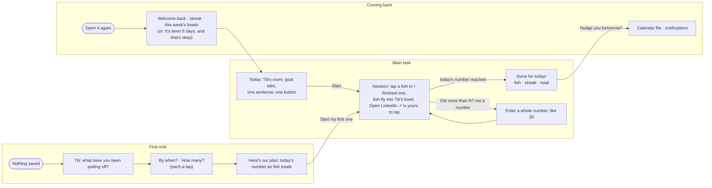
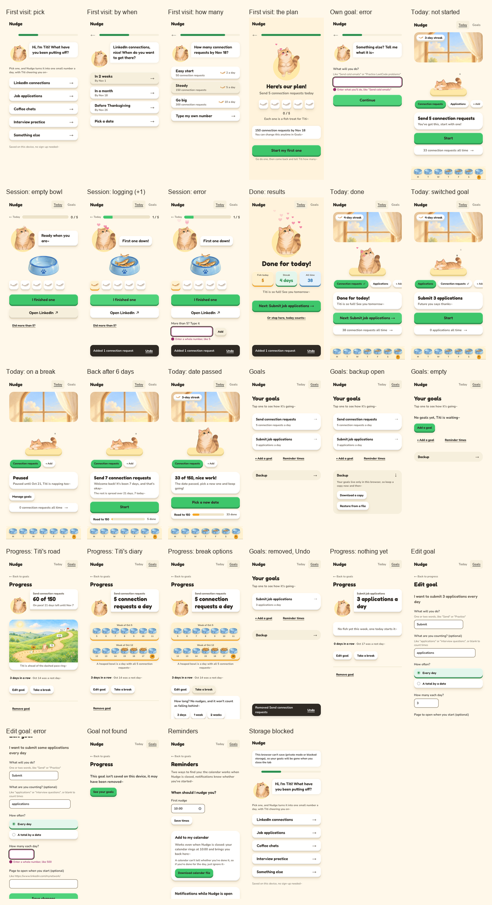

# Nudge

A goal pusher for students in recruiting season. The tasks that matter but you keep putting off (LinkedIn connections, applications, coffee chats, interview practice) become one number for today, and Titi the cat pushes you to start with just one: every one you finish is a fish treat for her.

Design, Build, Ship · Assignment 3 (Patterns & Flows).

- **Live:** [dbs-a3.vercel.app](https://dbs-a3.vercel.app)
- **Flows:** [flows.md](flows.md) (first visit, the main task, coming back, managing goals)
- **Every state:** [docs/states.png](docs/states.png)
- **Onboarding research:** [research.md](research.md) (Beeminder, Duolingo, Finch)
- **Decision log (Chinese):** [log.md](log.md) · **Agent rules:** [AGENTS.md](AGENTS.md)

## The main task

> I pick a goal → it tells me today's number and I do the first one now → if I haven't started, it nudges me again (and again) → I come back and see how close I am.

The three flows in one picture (each step is a route; every state and error is drawn in [flows.md](flows.md)):



## The three flows

| Flow | What happens | Where |
|---|---|---|
| First visit | Titi asks one thing per screen, every answer is a tap: what you've been putting off, by when, how many (each choice shown as fish treats a day), then today's plan and the first task right away. Nothing to read, no empty screen, no sign-up. | `/` with nothing saved; the same walk is "+ Add" later |
| Main task | Today is Titi's room: the painted window changes with the hour, Titi waits on her mat, then which goal is up now, one sentence and the Start button; this week's bowls sit on a shelf that stays at the foot of a phone screen while the room scrolls. Tap Start to open the session (its own page); open LinkedIn from there if you want it, come back and tap the fish you just finished (or "I finished one"). Back returns to the room and keeps the session going. Each log sends a fish into Titi's bowl; reaching today's number ends in a results screen whose three cards count up. | `/`, `/session` |
| Coming back | It remembers: your goals, the streak (one for the whole app, with a forgiven rest day a week), what you did this week. A warm line says why today's number is what it is. Reminders come two ways: a calendar file that works when Nudge is closed, and browser notifications that stop once you've started. | `/`, `/reminders` |



## Design decisions

- **Encourage, don't remove the push.** The app still pushes people to finish, always by cheering them on. Nudges get firmer through the day but never shame; a missed deadline leads with progress ("10 of 100, nice work!") and then the next step.
- **Fish treats go to Titi, numbers go to the goal.** The streak and the week of bowls are shared by every goal; the daily number, the session bowl, Titi's road (a by-date goal) and Titi's diary (a daily goal) belong to one goal. Each symbol keeps one meaning: a fish is one task done, a bowl is one day, and Titi's road marks its quarters with signposts.
- **Painted pieces are never stitched.** The window, the bowls and Titi each stand alone on plain interface, never laid over another painting; Titi keeps her drawn frame animations. (An earlier version composited everything into one room and looked pasted.) The one exception is Titi's road, where the things that move with progress are drawn on the painted hillside, smaller as they go up the hill.
- **Clay, not outlines.** A warm light page where the few things you act on are saturated and chunky (a highlight on top, a solid lip underneath, pressing sinks it), everything else quiet.
- **No full stops in the interface.** Encouraging lines end with "!", easygoing ones with "~"; errors and labels take no end punctuation. A test enforces it.
- **Undo beats confirm.** Removing a goal happens at once and Goals offers Undo; only replacing everything from a backup asks first.
- **Simplicity.** Navigation is Today and Goals. Reminders are reached from Goals and from the done screen. Adding a goal is the same walk as the first visit, so there is one way to make a goal.

Research behind these choices: [research.md](research.md), and a study of Duolingo's structure (a path home, a persistent streak, lesson-complete metrics), visuals and voice.

## Accessibility

- Every page and error state was checked with axe-core (WCAG 2.2 AA + best practices): 0 violations across 16 pages and states.
- Keyboard only: the whole first visit, a session from Start to done, and Undo were walked with Tab and Enter; focus moves to each new screen's heading.
- Text contrast, checked pair by pair: ink 13.4:1 and muted 5.7:1 on the page; ink on the green button 6.4:1 (7.3:1 on hover), on honey 7.0:1, on sky 5.6:1; control edges 3.6:1; the error berry 6.7:1.
- Every field has a visible label; every action is a real button or link; the drawn animations fall back to stills under `prefers-reduced-motion`, and the count-ups, hops and hearts stop.

## First-run check

On 2026-10-18, after the deploy, a fresh agent (no access to the code or these docs, a cleared browser at 375px wide) was given the live URL and the goal "set up a goal to send 150 LinkedIn connection requests by a date, do your first two today, and see how you are doing", then told to pretend to come back the next day. Its report, condensed, and what changed:

| What the tester found | Severity | What changed |
|---|---|---|
| "Nothing on the first screen says what Nudge does; I inferred it from the question and the job-search presets." | Medium | One line now sits under Titi's first question: "Pick one, and Nudge turns it into one small number a day, with Titi cheering you on~" |
| "The caption talks about a pace flag, but the only flag on the road is the deadline. I could not tell what 'a little ahead' referred to." (The pace marker is a dashed ring, and it is hidden when it would sit under Titi.) | Medium | The caption now names the dashed ring, and says "Titi is right on pace!" when the ring is hidden |
| "Reminder times is only a small text link on Goals." | Medium | Kept as is, on purpose: the navigation holds only Today and Goals, and reminders are offered on the done screen at the moment they are useful |
| "The amount buttons read as unnamed buttons." | Medium | Checked: each button's accessible name is its label and detail ("Steady, 150 connection requests"); axe reports no `button-name` issue, and Playwright finds them by name. No change |
| "Titi was an empty yellow circle for about a second on first load." | Low | Her sitting loop is now preloaded from the layout |
| "The window said 'morning' at 15:00." | Low | The daytime painting is now read out as "daytime" (it covers 5:00 to 15:59) |
| "Edit goal says Back to Today, but I came from Progress." | Low | Back now returns to the goal's progress page |
| Worked well: inline errors with an example and focus moved to the field; the Undo toast; fish landing in the bowl and "2 done, 1 to go!"; the welcome-back line that recomputes today's number; dates shown beside "In 2 weeks". | | Kept |

One thing the tester saw twice and could not make happen again: the progress page jumping to Today on its own, once right after Save changes and once a few seconds after a direct load. There is no redirect in that route's code (the only navigations are Save → progress and Remove → Goals), and three further attempts stayed put. It is noted here rather than claimed fixed.

## Build and check

```bash
npm install
npm run dev        # http://localhost:3000
npm test           # vitest, 127 tests (quota, streak, nudges, copy rules, onboarding, undo)
npm run build
```

Data is saved only in this browser (localStorage). No accounts, database or APIs. Next.js 16, Tailwind CSS 4, deployed on Vercel.

## Credits

- Titi, her bowls, the window paintings and the hillside on Titi's road were generated with GPT from photos and prompts by the author, then cut out and assembled here (see [log.md](log.md) for every prompt and decision).
- Fonts: Fredoka and Nunito (Google Fonts).
- Built by directing Claude Code; the decision log records what was asked, what was proposed and what was chosen, in Chinese.
