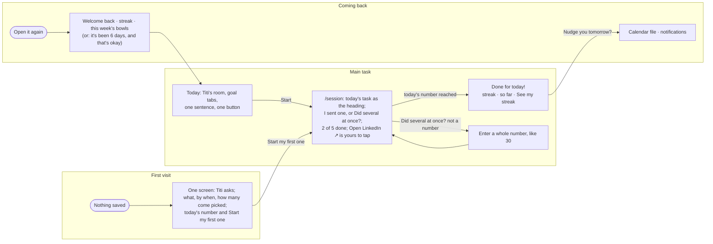
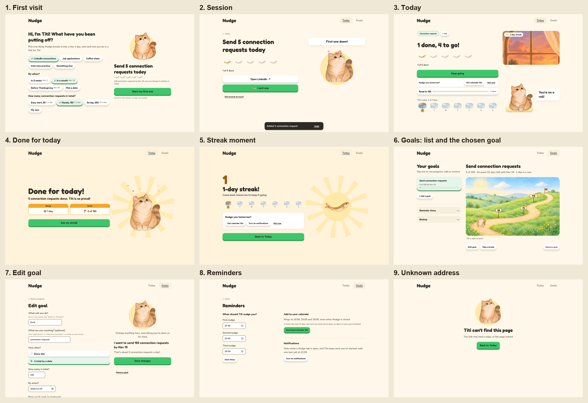

# Nudge

A goal pusher for students in recruiting season. The tasks that matter but you keep putting off (LinkedIn connections, applications, coffee chats, interview practice) become one number for today, and Titi the cat pushes you to start with just one: every one you finish is a fish treat for her.

Design, Build, Ship · Assignment 3 (Patterns & Flows).

- **Live:** [dbs-a3.vercel.app](https://dbs-a3.vercel.app)
- **Flows:** [flows.md](flows.md) (first visit, the main task, coming back, managing goals)
- **Every state:** [docs/states.png](docs/states.png) (17 phone screens, every error) · [docs/desktop.png](docs/desktop.png) (9 desktop pages)
- **Design system:** Fish Treat, on Claude (tokens, type, clay and focus rules, every component with a live preview, and Titi's poses): https://claude.ai/artifact/8ZLSKPpy6jRFPHJtqfZXCw
- **Onboarding research:** [research.md](research.md) (Beeminder, Duolingo, Finch)
- **Decision log (Chinese):** [log.md](log.md) · **Agent rules:** [AGENTS.md](AGENTS.md)

## The main task

> I pick a goal → it tells me today's number and I do the first one now → if I haven't started, it nudges me again (and again) → I come back and see how close I am.

The three flows in one picture (each step is a route; every state and error is drawn in [flows.md](flows.md)):



## The three flows

| Flow | What happens | Where |
|---|---|---|
| First visit | One screen: Titi asks, and three rows of one-tap answers (what, by when, how many) come already picked, so today's number and "Start my first one" are on the first screen; every tap updates the number, and "Something else" opens one field on the same page. Nothing to read, no empty screen, no sign-up. | `/` with nothing saved; the same screen is "+ Add a goal" later |
| Main task | Today is Titi's room: the painted window changes with the hour, Titi waits on her mat, then which goal is up now, one sentence and the Start button; this week's bowls sit on a shelf that stays at the foot of a phone screen while the room scrolls. Tap Start to open the session (its own page); the heading is today's task ("Send 5 connection requests today"); the green button is whatever comes next, "Open LinkedIn" until it has been opened or one is logged, then the one that says what you did ("I sent one"), or "Did several at once?" for +2, All N, or a typed number. The row of fish only shows how far today has come, so nothing looks tappable that isn't. Back returns to the room and keeps the session going. Each log fills the next fish and Titi hops; reaching today's number ends in a results screen: what you did in one line, then two honey badges that count up (the streak, and how far the whole goal has come, "56 of 150"), and "See my streak" before "Back to Today". | `/`, `/session` |
| Coming back | It remembers: your goals, the streak (one for the whole app, with a forgiven rest day a week), what you did this week. A warm line says why today's number is what it is. Reminders come two ways: a calendar file that works when Nudge is closed, and browser notifications that stop once you've started. | `/`, `/reminders` |




## Design decisions

- **Encourage, don't remove the push.** The app still pushes people to finish, always by cheering them on. Nudges get firmer through the day but never shame; a missed deadline leads with progress ("10 of 100, nice work!") and then the next step.
- **Fish treats go to Titi, numbers go to the goal.** The streak and the week of bowls are shared by every goal; the daily number, the session bowl, Titi's road (a by-date goal) and Titi's diary (a daily goal) belong to one goal. Each symbol keeps one meaning: a fish is one task done, a bowl is one day, and Titi's road marks its quarters with signposts.
- **Painted pieces are never stitched.** The window, the bowls and Titi each stand alone on plain interface, never laid over another painting; Titi keeps her drawn frame animations. (An earlier version composited everything into one room and looked pasted.) The one exception is Titi's road, where the things that move with progress are drawn on the painted hillside, smaller as they go up the hill.
- **Clay means pressable.** A warm light page where the few things you act on are chunky clay (a highlight on top, a solid lip underneath, pressing sinks it); everything you only read is flat, so a lip is a promise that something will happen when you tap.
- **No full stops in the interface.** Encouraging lines end with "!", easygoing ones with nothing at all; errors and labels take no end punctuation. A test enforces it.
- **Undo beats confirm.** Removing a goal happens at once and Goals offers Undo; only replacing everything from a backup asks first.
- **A welcome that is Titi's.** The first screen opens with Titi waving, a line that says what Nudge does in her terms (each one is a fish for her), today's empty fish under the number, and "no sign-up needed" on phones too. Coming back, her greeting ("Last week: 2 fish for Titi over 1 day!", "It's been 5 days, and that's okay") is in a bubble beside her, not a grey line under the heading, and she is awake when she speaks: waving to greet you, stretching when you are back after days or from a reminder. A reminder visit always opens with "You came back!", even on a Monday; last week's summary waits for the next normal visit and is said once a week.
- **Task first on a desktop.** From 1024px every page shares one frame and a 12-column grid, so the logo and navigation never move between pages. The task takes the left seven columns (a size larger: a 48px task sentence, 18px body) and Titi the right five, every column top-aligned; on Today the window starts level with the goal tabs and Titi's mat ends level with the week's bowls. Goals shows the list beside the chosen goal (list and detail): the list column ends with Reminder times and Backup as two rows of one kind, and the goal reads top to bottom, its name, one line of where it stands, the bowls or the road across the column, then Edit, Take a break and Remove in one row; every task page starts 32px under the navigation, with the back link and the heading in the same place on every page, while the done and streak screens are centred; Reminders puts the times on the left and the calendar and notifications on the right; the first visit and Edit goal keep one column of questions or fields on the left and, on the right, Titi with the live result and the button, which stay in view while the left side scrolls. A phone looks exactly as before.
- **Simplicity.** Navigation is Today and Goals. Reminders are reached from Goals, and Today asks "Nudge you tomorrow?" in one row after the first log. Adding a goal is the same walk as the first visit, so there is one way to make a goal.

Research behind these choices: [research.md](research.md), and a study of Duolingo's structure (a path home, a persistent streak, lesson-complete metrics), visuals and voice.

## Retention

Built around James Clear's four laws as one loop, so each visit leads to the next (Week 3, slide 62).

| Law | In Nudge |
|---|---|
| Make it obvious | A calendar file and browser nudges at your times. After your first log, Today asks "Nudge you tomorrow?" in one row under the button; "Not now" hides it until tomorrow |
| Make it attractive | Your progress is the first thing you see: the streak on Titi's window, this week's bowls ("Titi's week, 3 of 7 days"), Titi's road. On the second day Titi points at the streak once |
| Make it easy | One button on Today. Tapping a nudge opens Today as a nudge visit ("You came back! That's the hardest part") with Start one tap away; "Keep going" picks up where you left off |
| Make it satisfying | Each one fills a fish and Titi hops; a finished day ends in a celebration and the streak's own moment; a weekly line counts last week's fish |

**Habits that are good for you.** Nudge pushes, but it never shames: one rest day a week is forgiven automatically, a missed stretch is met with "It's been 6 days, and that's okay", browser nudges stop once you've started and are capped at four a day, and the shortfall is spread over the days left instead of piling onto today.

## Accessibility

- Every page and error state was checked with axe-core (WCAG 2.2 AA + best practices) at 390px and 1440px: 0 violations across 16 pages and states, plus the 404 page.
- Keyboard only: the whole first visit, a session from Start to done, and Undo were walked with Tab and Enter; focus moves to each new screen's heading.
- Text contrast, checked pair by pair: ink 13.4:1 and muted 5.7:1 on the page; ink on the green button 6.4:1 (7.3:1 on hover), on honey 7.0:1, on sky 5.6:1; control edges 3.6:1; the error berry 6.7:1; deep honey text (the streak number, badge numbers) 4.8:1 on the done screen and 5.2:1 on white. That last pair was 2.95:1 until the requirements check on 2026-10-19: axe had not flagged it because the big streak number is hidden from screen readers, but it is still text people read.
- Every field has a visible label; every action is a real button or link; the drawn animations fall back to stills under `prefers-reduced-motion`, and the count-ups, hops and hearts stop.

## First-run check

Two rounds, each by a fresh agent that saw only the live URL (no code, no docs), with a cleared browser.

### Round 1

On 2026-10-18, after the deploy, a fresh agent (no access to the code or these docs, a cleared browser at 375px wide) was given the live URL and the goal "set up a goal to send 150 LinkedIn connection requests by a date, do your first two today, and see how you are doing", then told to pretend to come back the next day. Its report, condensed, and what changed:

| What the tester found | Severity | What changed |
|---|---|---|
| "Nothing on the first screen says what Nudge does; I inferred it from the question and the job-search presets." | Medium | One line now sits under Titi's first question: "Pick one thing. Nudge breaks it into a few a day, and each one you do is a fish for Titi", and the bar at the foot draws today's empty fish under the number |
| "The caption talks about a pace flag, but the only flag on the road is the deadline. I could not tell what 'a little ahead' referred to." (The pace marker is a dashed ring, and it is hidden when it would sit under Titi.) | Medium | The caption now names the dashed ring, and says "Titi is right on pace!" when the ring is hidden |
| "Reminder times is only a small text link on Goals." | Medium | Kept in Goals on purpose (the navigation holds only Today and Goals), but it is now a full row like Backup, and since then Today asks "Nudge you tomorrow?" right after the first log |
| "The amount buttons read as unnamed buttons." | Medium | Checked: each button's accessible name is its label and detail ("Steady, 150 connection requests"); axe reports no `button-name` issue, and Playwright finds them by name. No change |
| "Titi was an empty yellow circle for about a second on first load." | Low | Her sitting loop is now preloaded from the layout |
| "The window said 'morning' at 15:00." | Low | The daytime painting is now read out as "daytime" (it covers 5:00 to 15:59) |
| "Edit goal says Back to Today, but I came from Progress." | Low | Back now returns to the goal's progress page |
| Worked well: inline errors with an example and focus moved to the field; the Undo toast; fish landing in the bowl and "2 done, 1 to go!"; the welcome-back line that recomputes today's number; dates shown beside "In 2 weeks". | | Kept |

One thing the tester saw twice and could not make happen again: the progress page jumping to Today on its own, once right after Save changes and once a few seconds after a direct load. There is no redirect in that route's code (the only navigations are Save → progress and Remove → Goals), and three further attempts stayed put. It is noted here rather than claimed fixed.

### Round 2

On 2026-10-19, after the redesign (one-screen first visit, task-first desktop, Titi's bubble, the retention loop), a second fresh agent was given the live URL and the goal "I'm a student in recruiting season. Set up a goal to send job applications, do two today, see how I'm doing, then come back the next day and keep going", on a phone (390x844) and a desktop (1440x900), with one deliberate form mistake, a simulated next day and a five-day gap, a tapped reminder (`/?from=nudge`) and keyboard only. It reported 21 findings (6 Medium, the rest Low); the 12 below were fixed, the rest are kept on purpose.

| What the tester found | Severity | What changed |
|---|---|---|
| Raising the daily number from 2 to 3 in Edit goal turned finished days into "some done". | Medium | An edit that changes the number, type or date keeps the old values as applying up to yesterday; the diary and the week's bowls judge each day by the number it had then |
| "Oct 18 was a rest day", though no rest day was set. | Medium | "Oct 18 was your free rest day, one a week" |
| The streak counted a partial day, but the diary said a heaped bowl means all done. | Medium | The legend adds "and any fish keeps the streak" |
| "Take a break" seemed to do nothing on a phone (the choices opened below the screen). | Medium | The choices scroll into view and focus moves to the first |
| "Add to calendar" downloaded a file without warning, and the file covers about two weeks. | Medium | "Get calendar file", and Reminders says "It covers the next 14 days" |
| During a break, Today still asked "Nudge you tomorrow?". | Low-Medium | Not asked while a goal is on a break |
| Two "Add a goal" buttons on an empty Goals page. | Low | One |
| "How many did you do?" with no choices under it (one left); chips "+3 +4 All 5". | Low | Fixed steps +2, +3, +5, then "All N"; with none to offer, the field asks the question itself |
| 0 got "Enter a whole number". | Low | "Enter a number above 0, like 3" |
| "Titi's diary, 2 so far": 2 of what? | Low | "Titi's diary, 2 applications so far" |
| An unknown address was a bare 404. | Low | Titi says she can't find the page, with "Back to Today" |
| No confirmation after Save changes. | Low | A "Saved changes" toast on the progress page |

Kept on purpose: reminders live under Goals (the navigation is Today and Goals only, and Today asks after the first log); the reminder card shows at the start of a day until reminders are set up; Remove goal acts at once with Undo, no "are you sure"; very large numbers are allowed (up to 100,000); on a phone the bar with today's number and Start stays pinned over the lower choices; reminder times are sorted on save; the streak and this week's bowls can differ on a Monday (yesterday was last week).

Worked well, in the tester's words: the first screen's purpose was "mostly clear" and adapted to "Job applications" ("Where do you apply?"); errors sit next to the field and focus jumps to the first; logging is "fast and satisfying"; coming back after five days "stayed gentle"; keyboard-only setup and logging worked; no sideways scroll at 390px.

## Working with the agent

- **Plan first, one stage at a time.** The tool, its main-task sentence and the three flows were worked out in plan mode before any code ([plan.md](plan.md), [flows.md](flows.md)); onboarding research ran as three subagents (Beeminder, Duolingo, Finch).
- **Show before building.** For anything visual the agent built the change in a separate copy of the app and sent screenshots (phone and desktop, before and after); only an approved version was moved into the real code, and nothing was pushed without an explicit "push".
- **A second session as reviewer.** A separate, read-only Claude session checked the app against the course slides and this brief and sent findings; the user decided what to change. Two first-run checks by fresh agents (above) did the same as brand-new users.
- **Checks on every change.** Unit tests (164), a scripted walk of all three flows with mouse and keyboard at 390px and 1440px, axe on every page, and a build of the exact commit in a clean copy before each push.
- **Easy:** turning a decision into working, tested code fast; measuring things a person eyeballs (where an error lands on a 667px phone, whether two columns line up, a contrast ratio); keeping a full decision log.
- **Hard:** visual judgement. The first versions read as a phone layout stretched onto a desktop, and balance, emphasis and "does this look tappable" took several rounds of the user looking and saying what felt off. Several sessions sharing one working folder once let half of another session's change into a commit and broke a deploy; since then every commit names its files and is built in isolation first. Keeping the docs in step with a fast-changing UI also needed a deliberate pass at the end.

## Build and check

```bash
npm install
npm run dev        # http://localhost:3000
npm test           # vitest, 164 tests (quota, streak, nudges, goal history, copy rules, onboarding, storage, undo)
npm run build
```

Data is saved only in this browser (localStorage). No accounts, database or APIs. Next.js 16, Tailwind CSS 4, deployed on Vercel.

## Credits

- Titi, her bowls, the window paintings and the hillside on Titi's road were generated with GPT from photos and prompts by the author, then cut out and assembled here (see [log.md](log.md) for every prompt and decision).
- Titi's later poses were generated with GPT too: the wave was made on a green screen and keyed out, and walk and paw tap were cut from generated sprite sheets, so small details can shift between frames. The loaf and stretch are single stills that code moves.
- Fonts: Fredoka and Nunito (Google Fonts).
- Built by directing Claude Code; the decision log records what was asked, what was proposed and what was chosen, in Chinese.
