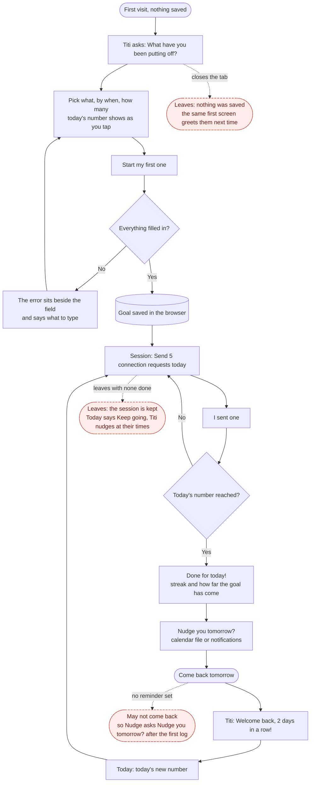

# Nudge

A goal pusher for students in recruiting season. The tasks that matter but you keep putting off (LinkedIn connections, applications, coffee chats, interview practice) become one number for today, and Titi the cat pushes you to start with just one: every one you finish is a fish treat for her.

Design, Build, Ship · Assignment 3 (Patterns & Flows).

- **Live:** [dbs-a3.vercel.app](https://dbs-a3.vercel.app)
- **Flows:** [flows.md](flows.md) (first visit, the main task, coming back, managing goals; every decision and error)
- **Every state:** [docs/states.png](docs/states.png) (17 phone screens, every error) · [docs/desktop.png](docs/desktop.png) (9 desktop pages)
- **First-run checks:** [docs/first-run-check.md](docs/first-run-check.md) (two rounds by fresh agents, every finding and what changed)
- **Design system:** Fish Treat, on Claude (tokens, type, clay and focus rules, every component, Titi's poses): https://claude.ai/artifact/8ZLSKPpy6jRFPHJtqfZXCw
- **Onboarding research:** [research.md](research.md) (Beeminder, Duolingo, Finch)
- **Decision log (Chinese):** [log.md](log.md) · **Agent rules:** [AGENTS.md](AGENTS.md)

## The main task

> I pick a goal → it tells me today's number and I do the first one now → if I haven't started, it nudges me again (and again) → I come back and see how close I am.



## The three flows

| Flow | What happens | Where |
|---|---|---|
| First visit | One screen, nothing to read: Titi asks, the answers come already picked, and today's number with "Start my first one" is on the first screen. No sign-up | `/`; the same screen is "+ Add a goal" later |
| Main task | Today is Titi's room with one button. The session page logs one at a time ("I sent one") or several at once, each fish fills and Titi hops; reaching today's number ends in a results screen and the streak | `/`, `/session` |
| Coming back | It remembers your goals, the streak and this week. Titi greets you by what happened since your last visit, and reminders come as a calendar file or browser notifications | `/`, `/reminders` |

## Design decisions

- **Encourage, don't remove the push.** Nudges get firmer through the day but never shame; a missed deadline leads with progress ("10 of 100, nice work!").
- **One meaning per symbol.** A fish is one task done, a bowl is one day; the streak and the week are shared by every goal, the daily number and Titi's road belong to one.
- **Painted pieces are never stitched.** The window, the bowls and Titi each stand alone on plain interface, so nothing looks pasted.
- **Clay means pressable.** Only things you can tap have the chunky clay lip; everything you only read is flat.
- **No full stops in the interface.** Encouraging lines end with "!", easygoing ones with nothing; a test enforces it.
- **Undo beats confirm.** Removing a goal happens at once with Undo; only replacing everything from a backup asks first.
- **A welcome that is Titi's.** She waves on the first screen, takes a pose for the amount you pick, and greets you in her own bubble when you come back.
- **Task first on a desktop.** From 1024px the task takes the left seven columns and Titi the right five, both columns sharing a top and bottom edge; Goals is list and detail on one page. A phone keeps its own layout.
- **Simplicity.** Navigation is Today and Goals; adding a goal is the same screen as the first visit, so there is one way to make a goal.

Research behind these choices: [research.md](research.md), and a study of Duolingo's structure, visuals and voice.

## Retention

Built around James Clear's four laws as one loop, so each visit leads to the next (Week 3, slide 62).

| Law | In Nudge |
|---|---|
| Make it obvious | A calendar file and browser nudges at your times. After your first log, Today asks "Nudge you tomorrow?" in one row under the button; "Not now" hides it until tomorrow |
| Make it attractive | Your progress is the first thing you see: the streak on Titi's window, this week's bowls ("Titi's week, 3 of 7 days"), Titi's road. On the second day Titi points at the streak once |
| Make it easy | One button on Today. Tapping a nudge opens Today as a nudge visit ("You came back! That's the hardest part") with Start one tap away; "Keep going" picks up where you left off |
| Make it satisfying | Each one fills a fish and Titi hops; a finished day ends in a celebration and the streak's own moment; a weekly line counts last week's fish |

**Habits that are good for you.** Nudge pushes, but it never shames: one rest day a week is forgiven automatically, a missed stretch is met with "It's been 6 days, and that's okay", browser nudges stop once you've started and are capped at four a day, and the shortfall is spread over the days left instead of piling onto today.

## Accessibility

- axe-core (WCAG 2.2 AA) on every page and error state at 390px and 1440px: 0 violations.
- Keyboard only: the first visit, a session from Start to done, and Undo all work with Tab and Enter; focus moves to each new screen's heading.
- Every text and control pair meets WCAG AA contrast, checked pair by pair (ink 13.4:1 on the page, ink on the green button 6.4:1, control edges 3.6:1).
- Every field has a visible label, every action is a real button or link, and animations stop under `prefers-reduced-motion`.
- Screen reader, without looking: the first visit was filled in using only the keyboard and what Chrome's accessibility tree hands a screen reader. It reads one heading, three labelled groups of choices whose names carry their detail ("Steady, 150, 5 a day") and Start, in six Tab stops; an empty field moves focus to "What will you do?", marked invalid, with the hint and the error as its description; in the session each log is announced ("First one down!", "Added 1 cold email").
- Enough time: the Undo message waits while the pointer or keyboard focus is on it, so Undo can always be reached; it leaves 8 seconds after that.

## First-run check

Two fresh agents, given only the live URL and a cleared browser, used Nudge as brand-new users (2026-10-18 on a phone; 2026-10-19 on a phone and a desktop, with a form mistake, a next day, a five-day gap and keyboard only). The main findings and what changed:

| Round | What the tester found | What changed |
|---|---|---|
| 1 | Nothing on the first screen said what Nudge does | One line under Titi's question: "Pick one thing. Nudge breaks it into a few a day, and each one you do is a fish for Titi" |
| 1 | The road's caption mentioned a pace flag that was not there | The caption names the dashed ring, and says "Titi is right on pace!" when it is hidden |
| 2 | Raising the daily number in Edit goal turned finished days into "some done" | Edits keep the old number for the days before, so past days stay judged by the number they had |
| 2 | "Take a break" seemed to do nothing on a phone | The choices scroll into view and focus moves to the first |
| 2 | "Add to calendar" downloaded a file without warning | Renamed "Get calendar file", and Reminders says it covers the next 14 days |

Kept on purpose: reminders live under Goals, and Remove goal acts at once with Undo. Worked well, in the testers' words: errors next to the field with focus moved there, logging "fast and satisfying", and coming back after five days "stayed gentle". Every finding is in [docs/first-run-check.md](docs/first-run-check.md).

## Working with the agent

- **Plan first, one stage at a time.** The main-task sentence and the three flows were planned in plan mode before any code ([plan.md](plan.md)); onboarding research ran as three subagents.
- **Show before building.** Visual changes were built in a separate copy and shown as phone and desktop screenshots; only approved versions reached the real code, and nothing was pushed without an explicit "push".
- **A second session as reviewer.** A read-only Claude session checked the app against the course slides and the brief; the user decided what to change.
- **Checks on every change.** 170 unit tests, a scripted walk of all three flows with mouse and keyboard at 390px and 1440px, axe on every page, and a clean build of the exact commit before each push.
- **Easy:** turning a decision into tested code fast, and measuring what a person eyeballs (alignment, where an error lands, contrast).
- **Hard:** visual judgement. Balance and "does this look tappable" took several rounds of the user looking and saying what felt off.

## Build and check

```bash
npm install
npm run dev        # http://localhost:3000
npm test           # vitest, 170 tests (quota, streak, nudges, goal history, copy rules, onboarding, storage, message timing, undo)
npm run build
```

Data is saved only in this browser (localStorage). No accounts, database or APIs. Next.js 16, Tailwind CSS 4, deployed on Vercel.

## Credits

- Titi, her poses, her bowls, the window paintings and the hillside on Titi's road were generated with GPT from the author's photos and prompts, then cut out here (every prompt is in [log.md](log.md)).
- Fonts: Fredoka and Nunito (Google Fonts).
- Built by directing Claude Code; the decision log records what was asked, proposed and chosen, in Chinese.


