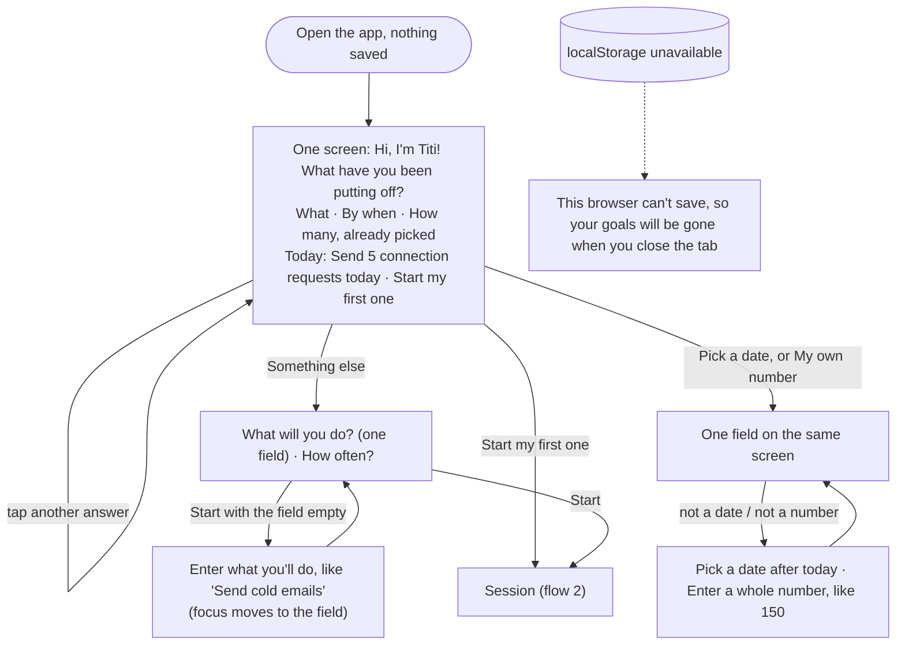
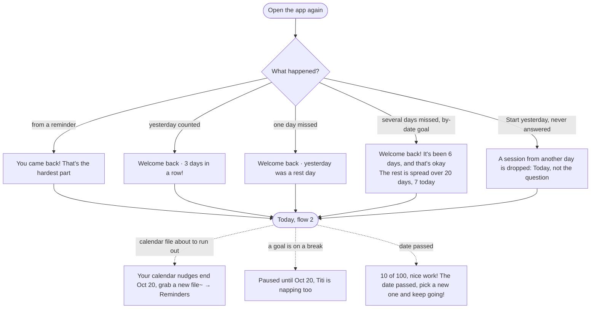

# Flows

Main task, as one sentence:

> I pick a goal → it tells me today's number and I do the first one now → if I haven't started, it nudges me again (and again) → I come back and see how close I am.

A tool you use every day has three flows: the first visit, the main task, and coming back. Each page below is a route in Next.js; every step, state and error was drawn first and built second, then walked at 390px and 1440px (see `docs/states.png` for every state).

## 1. First visit: useful right away

Nothing is saved. One screen (after the teacher's "the page is the onboarding"): Titi asks, and three rows of one-tap answers come already picked (LinkedIn connections, in a month, steady), so today's number and "Start my first one" are on the first screen; on a phone they stay pinned to the foot of the screen. Every tap updates the number. The same screen (`GoalWizard`) is "+ Add a goal" later, so a goal is always made the same way. The page you work on is no longer asked here: a preset suggests one, and Edit goal changes it.



## 2. The main task: Today, the session, and the results

Today is Titi's room: the window with the streak, Titi on her mat, the goal tabs, one sentence and one button, the road so far. The week of bowls is a shelf fixed at the foot of a phone screen (from 640px up it sits under the room), so Titi stays big and the button still lands on the first screen. The "Nudge you tomorrow?" card appears once, on the done screen.

```mermaid
flowchart TD
    T([Today]) --> R["Titi's room: window by the hour · Titi · this week's bowls"]
    R --> G["Goal tabs: pick which goal is up now (remembered while open)"]
    G --> B["Bubble: 'Send 5 connection requests' + a nudge line\nStart on LinkedIn ↗"]
    B -->|Start| S["/session: Send 5 connection requests today\nTiti cheering, a row of fish that fills (2 of 5 done)\nOpen LinkedIn ↗ (only here, only if you tap it) · I sent one · Did several at once?"]
    S -->|I sent one, or +2 / All N / a typed number| F["The next fish fills, Titi hops\nToast: Added 2 · Undo"]
    F --> S
    S -->|Did several at once? → not a number| SE["Enter a whole number, like 30"] --> S
    S -->|← Today, or the browser's Back| T
    F -->|today's number reached| D["Done for today! Three cards count up:\nfish today · streak · road"]
    D -->|Next goal| S
    D -->|Nudge you tomorrow? (calendar · notifications · not now)| D
    D -->|Or stop here| T2["Today, done state: Titi is so full"]
```

The session is its own page: Start never opens a website; "Open LinkedIn ↗" in the session does, only when tapped. Leaving keeps the session, so Today says "Keep going". The nudge line changes through the day (gentle → firmer → one last call) and never shames. The bowl in the session belongs to the goal being worked on, so it always agrees with the bar; the week of bowls on Today is where every goal counts together. Leaving the session leaves its Undo toast behind, so it never covers the Today button.

## 3. Coming back: it remembers



One streak for the whole app, like Duolingo's: a day counts when any goal got at least one, with one forgiven rest day a week.

## 4. Managing goals

```mermaid
flowchart TD
    GL([Goals]) --> C["A card per goal: title, one line, a small road bar"]
    C -->|tap| PR["Progress: Titi says the big number and the pace\nTiti's road or Titi's diary · days in a row · Edit goal · Take a break · Remove goal"]
    PR -->|Edit goal| E["Edit form: errors beside the field, cleared as you fix them"]
    E -->|Save changes| PR
    PR -->|Take a break| BR["3 days · 1 week · 2 weeks · Never mind"] --> PR
    PR -->|Remove goal| U["Goals, with a toast: Removed X · Undo (8 s)"]
    U -->|Undo| GL
    GL -->|+ Add a goal| WZ["GoalWizard (flow 1)"]
    GL -->|Reminder times| RM["Reminders: times · calendar file · notifications"]
    GL -->|Backup (folded)| BK["Download a copy · Restore from a file (confirm, since it replaces everything)"]
```

Removing one goal uses Undo; replacing everything from a backup uses a real confirm.

## Pages and navigation

| Route | Page | Shared pieces |
|---|---|---|
| `/` | Today (first visit, Titi's room) | `AppShell`, `Nav` (Today · Goals; hidden until the first goal exists), `Button`, `Toast`, `CatArt`, `Room` |
| `/session` | Working through today's number, then the results; Back (the link or the browser's) returns to Today and keeps the session | `Session`, `Coins`, `Bowl`, `DoneToday` |
| `/goals` | Your goals, backup | `GoalCard`, `BackupSection` |
| `/goals/new` | Add a goal (the Titi walk) | `GoalWizard`, `SetupFrame`, `Choices`, `OwnAnswer`, `PlanStep` |
| `/goals/[id]` | Progress | `Road` (by-date goal), `Diary` (daily goal), `GoalActions` |
| `/goals/[id]/edit` | Edit goal | `GoalSetup`, `Field`, `RadioGroup` |
| `/reminders` | Reminder times, calendar file, notifications | `TimesForm`, `CalendarCard`, `NotificationsCard` |

Navigation holds only the core needs (Today, Goals); Reminders is reached from Goals and from the done screen. Every page has a skip link, one `h1`, and the same header in the same place.
