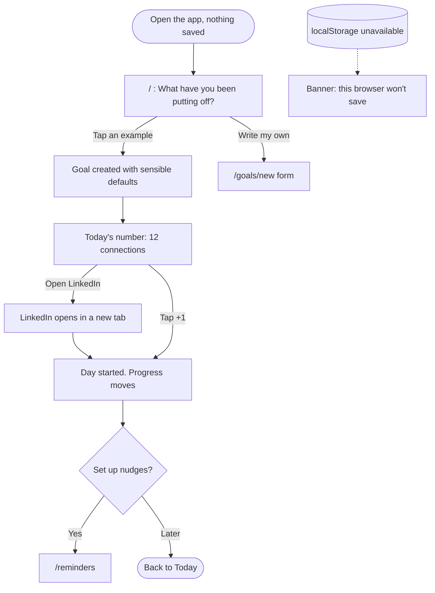
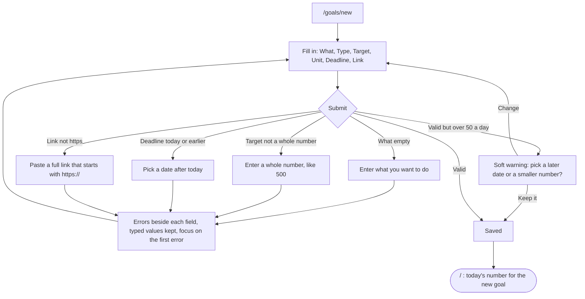
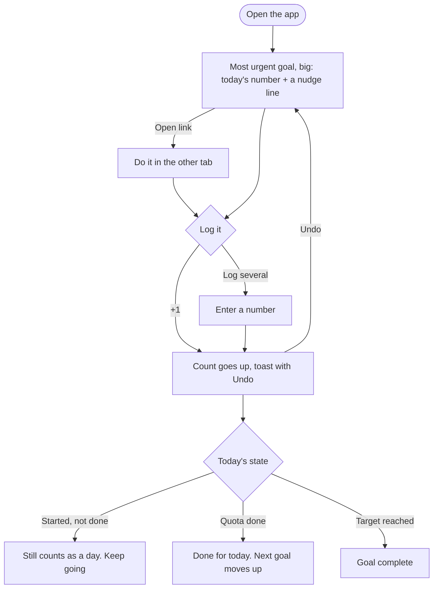
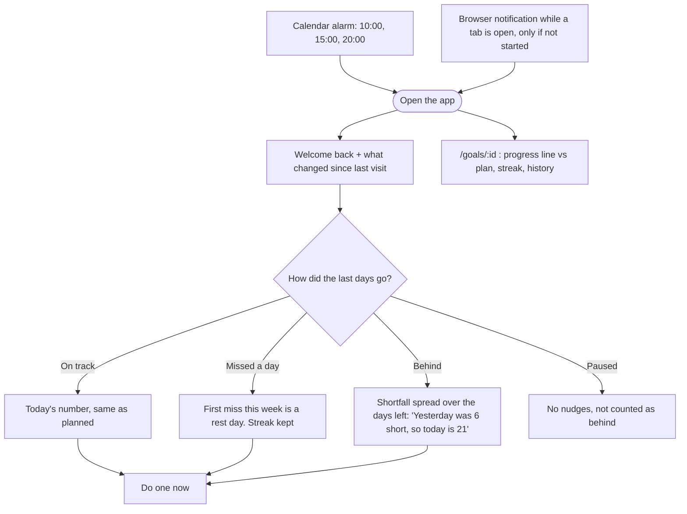

# Flows

Main task, as one sentence:

> I pick a goal → it tells me today's number and I do the first one now → if I haven't started, it nudges me again (and again) → I come back and see how close I am.

## 1. First visit: useful right away

## 2. The form and its errors

## 3. The daily task

## 4. Coming back: it remembers

## Pages and navigation

| Route | Step |
|---|---|
| `/` | First visit, daily task, coming back |
| `/goals/new`, `/goals/[id]/edit` | The form |
| `/goals` | All goals, pause, delete, backup |
| `/goals/[id]` | Progress for one goal |
| `/reminders` | Calendar file and browser notifications |

Shared navigation: Today · Goals · Reminders. Sub-pages have a Back link.
