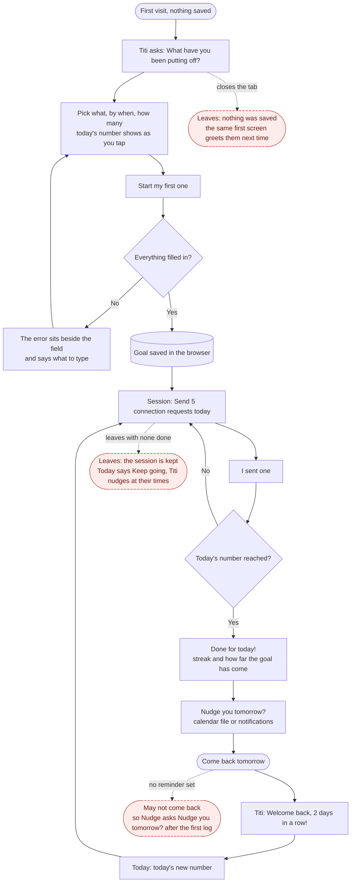
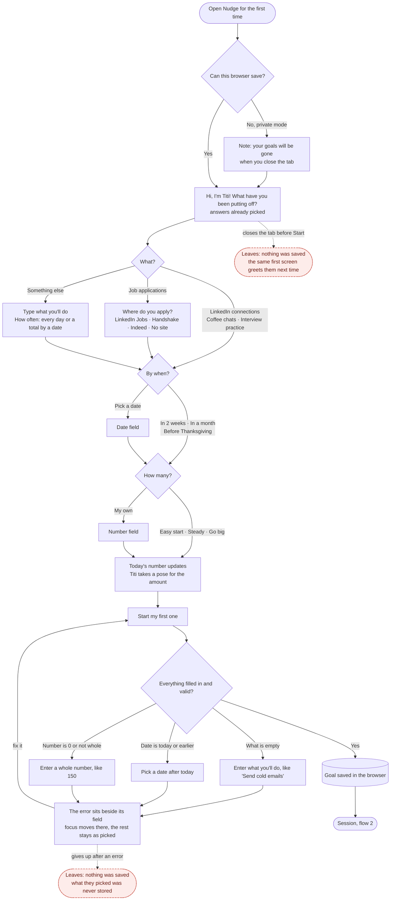
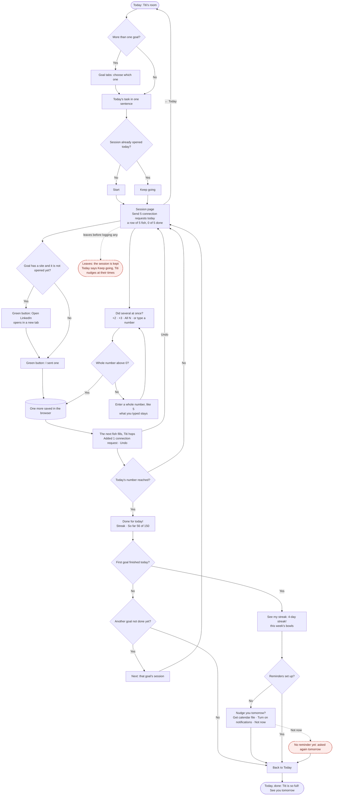
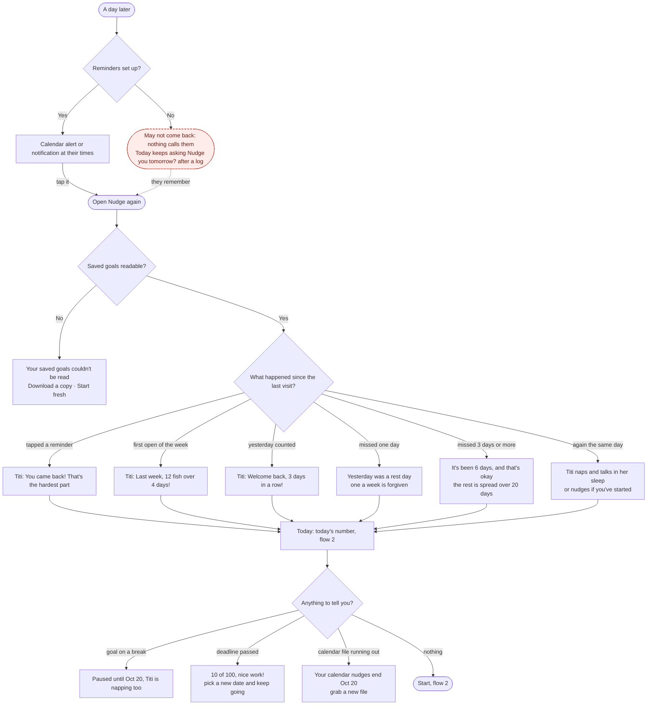
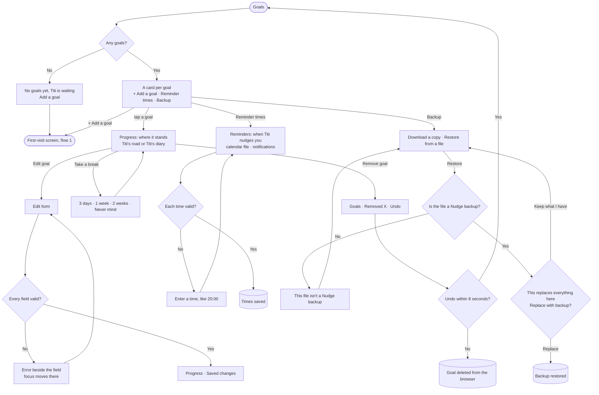

# Flows

Main task, as one sentence:

> I pick a goal → it tells me today's number and I do the first one now → if I haven't started, it nudges me again (and again) → I come back and see how close I am.

A tool you use every day has three flows: the first visit, the main task, and coming back. Each page below is a route in Next.js; every step, state and error was drawn first and built second, then walked at 390px and 1440px (see `docs/states.png` for every state).

## The whole loop

The three flows as one path, like the teacher's "I add an item → it's on my list → I come back on Sunday": every diamond is a check, every error loops back to where you fix it, the cylinder is the moment it is saved in the browser, and the red dashed ends are where people may give up, with what Nudge does about each.

## 1. First visit: useful right away

Nothing is saved. One screen (after the teacher's "the page is the onboarding"): Titi waves and asks (once you answer she takes a pose for the amount: a loaf, a walk, a jump, or a tap of the paw for your own number), one line says what Nudge does ("Pick one thing. Nudge breaks it into a few a day, and each one you do is a fish for Titi"), and three rows of one-tap answers come already picked (LinkedIn connections, in a month, steady), so today's number, its empty fish and "Start my first one" are on the first screen; on a phone they stay pinned to the foot of the screen (the fish are left out on short phones). Every tap updates the number. Job applications adds "Where do you apply?" (LinkedIn Jobs, Handshake, Indeed, no site). The same screen (`GoalWizard`) is "+ Add a goal" later, so a goal is always made the same way. On a desktop the questions are on the left and Titi, today's number and Start on the right.

## 2. The main task: Today, the session, and the results

Today is Titi's room. On a phone: the window by the hour (with the streak), Titi on her mat with what she says in her bubble beside her, the goal tabs (the goal shown now is a flat label; the others are buttons that switch to them), the task and its one button, "Nudge you tomorrow?" in one row once anything has been logged, the road or diary link, and the week's bowls fixed at the foot of the screen with "Titi's week, 3 of 7 days". On a desktop the same things are on a 12-column grid: the task on the left seven columns, the window and Titi on the right five.

The session is its own page: Start never opens a website; "Open LinkedIn ↗" in the session does, only when tapped. Leaving keeps the session, so Today says "Keep going". On Today, everything Titi says is in her bubble: a greeting on the day's first open, otherwise the day's nudge (gentle, then firmer, then one last call), and she naps and talks in her sleep until you start ("Zzz… one fish would wake me up").

## 3. Coming back: it remembers

One streak for the whole app, like Duolingo's: a day counts when any goal got at least one, with one forgiven rest day a week. A reminder visit always opens with "You came back!", even on a Monday; last week's summary then waits for the next normal visit, and is said once a week.

## 4. Managing goals

On a desktop, Goals is list and detail on one page: the list on the left four columns, the chosen goal on the right eight. Editing a goal's number keeps the past: earlier days stay judged by the number they had. Removing one goal uses Undo; replacing everything from a backup uses a real confirm.

## Pages and navigation

| Route | Page | Shared pieces |
|---|---|---|
| `/` | First visit (nothing saved), then Today: Titi's room | `AppShell`, `Nav` (Today · Goals; hidden until the first goal exists), `GoalWizard`, `Pills`, `TodayHome`, `Room`, `CatArt`, `Coins`, `NudgePrompt`, `StreakChip`, `Toast` |
| `/session` | Working through today's number, then the results and the streak moment; Back returns to Today and keeps the session | `Session`, `Coins`, `Button`, `Field`, `DoneToday`, `NudgePrompt`, `Toast` |
| `/goals` | Your goals; on a desktop with the chosen goal beside the list | `GoalsScreen`, `GoalCard`, `ProgressScreen`, `BackupSection`, `Toast` |
| `/goals/new` | Add a goal: the same one screen as the first visit | `GoalWizard`, `Pills`, `Field` |
| `/goals/[id]` | A goal's progress (on a desktop, inside Goals) | `GoalView`, `ProgressScreen`, `Road` (by-date goal), `Diary` (daily goal), `GoalActions`, `Toast` |
| `/goals/[id]/edit` | Edit goal | `GoalSetup`, `Field`, `RadioGroup`, `RemoveGoalButton` |
| `/reminders` | Reminder times, calendar file, notifications | `TimesForm`, `CalendarCard`, `NotificationsCard` |
| any other address | Not found, with the way back to Today | `AppShell`, `CatArt`, `ButtonLink` |

Navigation holds only the core needs (Today, Goals); Reminders is reached from Goals, and Today and the streak moment ask "Nudge you tomorrow?" after the first log. Every page has a skip link, one `h1`, and the same header in the same place.
